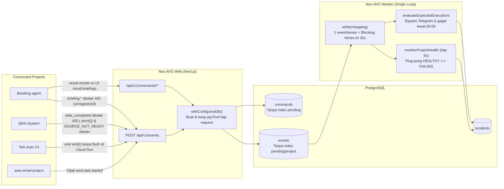

# Neo AVO & Ecosystem — System Logic Audit & Enhancement Roadmap

**Date:** 2026-11-18  
**Scope:** `neo-avo` (Core Backend, Worker, DB, Ops Intelligence, API/UI) + Connected Projects (`Breafing-agent`, `QRA-System`, `Telegram-report-agent` / Tele Auto V2, `auto-email-project`)

---

## Peta Masalah Utama pada Flow Ekosistem

---

## BAGIAN 1 — Celah Kontrak Lintas Project (*Cross-Project Contract Bugs*) [CRITICAL]

Celah paling berbahaya karena menyebabkan **silent failure** (telemetry ditolak `400 Bad Request` secara diam-diam atau status di UI tidak sinkron dengan kondisi sebenarnya).

### 1. `Breafing-agent` ↔ `Neo AVO`: Event Ditolak `400` & Hasil Regenerate Tidak Muncul di UI
* **Event `briefing.*` dan `config.*` Ditolak Neo AVO (`400 unknown_event_type`)**:
  - `Breafing-agent` (`src/briefing_agent/adapters/neo_avo.py` L12–L21) mendaftarkan `briefing.generated`, `briefing.sent`, `briefing.failed`, `config.target_pending`, dan `config.target_updated`, serta mengirimkannya di `generate_closing.py`, `generate_morning.py`, dan `nightly.py`.
  - Di Neo AVO (`src/events/types.ts` L61–L102), `eventDataSchemas` **sama sekali belum mendaftarkan** `briefing.*` maupun `config.*` (bahkan `src/health/contracts.ts` L33 mengecek `event.type === "briefing.completed"` yang tidak pernah dikirim oleh `Breafing-agent`). Akibatnya, seluruh event tersebut ditolak `400 Bad Request` oleh Neo AVO dan ditelan oleh `except` di `Breafing-agent`.
* **Mismatch Struktur Hasil Command `briefing.regenerate` (`results` vs `briefings`)**:
  - `RegenerateService.execute_regenerate` (`src/briefing_agent/application/regenerate.py` L86–L89) mengembalikan `{"status": "SUCCESS", "results": [...]}` dengan `status: "SENT"` per item.
  - UI Neo AVO (`app/ui/briefing-regenerate-control.tsx` L210–L274) membaca `result?.briefings` dan mengecek `b.status === "SUCCESS"`. Akibatnya, detail per-store hasil regenerate **tidak pernah tampil di UI**. Selain itu, saat `PARTIAL` (misal 1 store sukses, 1 gagal), `worker.py` (L170) melaporkannya sebagai `FAILED` tanpa mengisi `reason`, sehingga di UI hanya muncul `"Unknown failure"`.
* **Regenerate Sukses Tidak Memulihkan Health `briefing-agent`**:
  - Saat command `briefing.regenerate` berhasil dijalankan, `RegenerateService` tidak mengirim `task.completed` dengan `sent_count > 0`. Karena `briefing.sent` juga ditolak oleh Neo AVO, status `businessHealth` pada project `briefing-agent` tidak pernah pulih ke `HEALTHY` meskipun briefing sudah berhasil di-regenerate lewat dashboard.

### 2. `QRA-System` ↔ `Neo AVO`: Kegagalan Ekstraksi Tidak Terlapor & Event Recovery Ditolak Schema
* **Gagal `SOURCE_NOT_READY` & `PARSE_FAILED` Membuat Task Menyangkut di `running` Selamanya**:
  - Di `orchestrator.py` (L287–L312), ketika terjadi `SourceNotReadyError` atau `ParseFailedError`, orchestrator hanya memanggil `emit_event("qra.sales.source_not_ready", ...)` atau `"qra.sales.extraction_failed"` (tidak memanggil `"report.failed"` seperti pada blok `except Exception` di L352).
  - Di `src/qra/telemetry/neo_avo.py` (L60–L69), semua event `qra.sales.*` dan `qra.sheet.*` **tidak masuk dalam `QRA_OBSERVE_EVENT_TYPES`**, sehingga di-skip secara diam-diam (`return True`). Akibatnya Neo AVO menerima `task.started` di awal run, lalu **tidak pernah menerima `task.failed`** ketika sumber Quinos kosong atau gagal di-parse.
* **Event `qra.resolve_missing_dates.date_completed` Ditolak `400` oleh Zod `.strict()`**:
  - Di `resolve_missing_dates.py` (L208–L217), `QRA-System` mengirim field `"completeness"` dan `"sourceStatus"`.
  - Di Neo AVO (`src/events/types.ts` L22–L36), `qraCommandData` memakai `.strict()` tanpa kedua field tersebut, sehingga setiap event `date_completed` **selalu ditolak `400 invalid_event_data`**.
* **`taskId` Jatuh ke `"qra-anonymous-task"` & `eventId` Random UUID**:
  - Pada `reconciliation.py` (L50), `run_daily` mengirim `{"trigger": "DAILY", "business_date": target_date}` tanpa `run_id`/`taskId`, sehingga di `neo_avo.py` (L84) semua daily run tergabung ke satu task bernama `"qra-anonymous-task"`.
  - `eventId` pada `QRA-System` dan `Breafing-agent` masih menggunakan `uuid.uuid4()` acak, bukan ID deterministik berbasis run/transisi, sehingga jika ada retry HTTP akan tercatat sebagai event duplikat.

### 3. `Tele Auto V2` & `auto-email-project`: Fire-and-Forget Serverless & Telemetry Awal
* **Pelanggaran Invariant Serverless Flush (`INV-016` / ADR-016) di `Tele Auto V2`**:
  - Pada `src/observability/neo-avo-telemetry.ts` (L86–L95), `emitTelemetrySafely` menjalankan `void telemetry.emit(event)` tanpa di-`await` sebelum siklus HTTP/worker di Cloud Run selesai. Di Cloud Run, CPU langsung di-throttle begitu HTTP response dikembalikan, sehingga request telemetry yang masih di-flight berisiko terputus atau hilang.
* **`auto-email-project` Tidak Mengirim `task.started`**:
  - Pada `app/service.py` (L28–L103), `AutoEmailService.run` hanya mengirim `task.completed` atau `task.failed` di akhir eksekusi, tanpa `task.started` saat lock diambil.

---

## BAGIAN 2 — Celah Logic, Performa & Reliability pada Core Neo AVO [CRITICAL / HIGH]

### 4. Anti-Pattern Koneksi Database: Buat & Hancurkan `pg.Pool` di Setiap Request
* **Lokasi**: `src/db/client.ts` (L18–L25) & `src/projects/auth.ts` (L27–L31).
* **Masalah**: `withConfiguredDb()` membuat instance `new pg.Pool(...)` baru dan langsung memanggil `await pool.end()` pada blok `finally`. Pada satu request `POST /api/v1/events` atau `GET /api/v1/commands/pending`, `authenticateProjectTokenRequest()` memanggil `withConfiguredDb()` sekali, lalu route handler memanggil `withConfiguredDb()` kedua kalinya — artinya **1 HTTP request membuka dan menutup 2 connection pool PostgreSQL baru secara berurutan**.
* **Dampak**: Dengan `QRA-System` dan `Breafing-agent` melakukan polling command tiap 2 detik + dashboard polling tiap 2 detik, terjadi puluhan TCP/TLS handshake per menit ke PostgreSQL yang meningkatkan latency dan berisiko menghabiskan `max_connections`.
* **Solusi**: Gunakan **singleton `pg.Pool`** di level modul (`globalThis.__neoAvoPool`) dengan konfigurasi `max: 10`, `idleTimeoutMillis: 30_000`, `connectionTimeoutMillis: 5_000`, dan gabungkan query autentikasi token (`project_credentials` JOIN `projects`) menjadi 1 query tunggal.

### 5. Single-Threaded Worker Loop Blocking & Tanpa Isolasi Error
* **Lokasi**: `src/worker/index.ts` (L28–L53).
* **Masalah**:
  1. **Head-of-Line Blocking oleh AI (Vertex AI 30s)**: `await runOneOpsAnalysis(db)` dipanggil secara sinkron di dalam loop utama yang sama dengan `claimPendingEvent(db)` dan `dispatchOneTelegramNotification(db)`. Ketika ada incident yang memicu analisis Vertex AI (timeout hingga 30 detik di `src/ops/vertex.ts` L68), **seluruh pemrosesan event masuk, pengiriman alert Telegram, dan pengiriman command PUSH terhenti total** selama panggilan AI berlangsung.
  2. **1 Event per Iterasi + 5 Query Tambahan per Event**: Setiap 1 event selesai diproses, worker wajib menjalankan `dispatchOneTelegramNotification`, `pollTelegramCommands`, `runOneOpsAnalysis`, `expireCommands`, dan `deliverOnePushCommand` sebelum bisa mengambil event berikutnya.
  3. **Crash Loop Tanpa `try/catch`**: Pemanggilan `monitorProjectHealth`, `dispatchOneTelegramNotification`, `runOneOpsAnalysis`, `expireCommands`, dan `deliverOnePushCommand` **tidak dibungkus `try/catch`**. Satu error transien dari DB akan langsung mematikan proses worker.
* **Solusi**: Pisahkan loop worker menjadi *concurrent independent tickers* (pisahkan *fast path* event/alert/command dari *slow path* AI Ops Analyst & periodic checks), klaim event secara batch/drain sampai habis, dan bungkus setiap komponen dengan `try/catch` terisolasi.

### 6. Bug "Ping-Pong" Status Health (`HEALTHY` ↔ `FAILING` / `AWAITING_VERIFICATION`) Tiap 5 Detik
* **Lokasi**: `src/health/derivation.ts` (L96–L146), `src/health/monitor.ts` (L21–L95), `src/incidents/types.ts` (L68–L78).
* **Masalah**:
  1. `recoveryKey()` di `src/incidents/types.ts` hanya me-resolve incident bertipe `dependency.recovered`, `project.started`, dan `expected-run-overdue`. Incident `TASK_FAILURE` maupun `TELE_AUTO_*` **tidak pernah auto-resolve** ketika run berikutnya berhasil (`task.completed` / `tele_auto.run.completed`).
  2. Ketika event sukses baru masuk, `deriveHealthFromEvent` mengubah status project menjadi `HEALTHY` (dan memicu notifikasi transisi `FAILING -> HEALTHY`).
  3. Maksimal **5 detik kemudian**, `monitorProjectHealth` berjalan dan mengecek `if (openIncidents.length > 0) { nextBusiness = "FAILING"; }`, sehingga memaksa `businessHealth` **kembali menjadi `FAILING`**.
  4. Di `src/health/monitor.ts` (L54–L59), `latestFailureAt` dihitung dari `allIncidents` (termasuk incident yang sudah `RESOLVED`) menggunakan `inc.lastSeenAt`. Tiap 5 detik `monitorProjectHealth` juga melakukan query 100 event + seluruh incident per project di dalam satu transaksi.

### 7. Celah pada `Expected Execution Contracts` & `Ops Analyst` Enrichment
* **Jadwal Malam yang Melewati Tengah Malam (`00:00`) Tidak Akan Pernah Terdeteksi Missed**:
  - Di `src/ops/expected-executions.ts` (L16–L28), `expectedAtForDay(now, timezone, schedule)` hanya menghitung jadwal pada **hari kalender lokal saat ini (`now`)**. Jika ada kontrak dengan jadwal `23:45 WIB` dan `gracePeriodSeconds = 1200` (lewat tengah malam pukul `00:05 WIB`), saat pukul `00:05 WIB` `expectedAtForDay(now)` menghitung pukul `23:45 WIB` **nanti malam**, sehingga keterlambatan tidak pernah terdeteksi.
* **Incident `EXPECTED_EXECUTION_MISSED` Tidak Mengirim Alert Telegram & Tidak Memicu AI**:
  - Di `src/ops/expected-executions.ts` (L64), incident langsung di-`insert` ke tabel `incidents` tanpa melalui `recordIncidentForEvent()`. Akibatnya, tidak ada row di tabel `notifications` (tidak ada alert Telegram meskipun `CRITICAL`/`HIGH`) dan tidak ada analisis di `ops_analyses`.
* **Hasil Analisis AI (`Ops Analyst`) Tidak Pernah Dikirim/Update ke Telegram**:
  - Di `src/ops/analyst.ts` (L20), hasil analisis hanya disimpan ke DB tanpa mengirim notifikasi lanjutan atau meng-edit pesan Telegram (berbeda dengan PRD §21 & ADR-011).

### 8. Command Menggantung di Status `ACKNOWLEDGED` Selamanya & Mengunci Tombol UI
* **Lokasi**: `src/commands/repository.ts` (L32–L41) & `app/ui/qra-audit-control.tsx` (L110).
* **Masalah**:
  1. `expireCommands()` hanya mengubah status menjadi `EXPIRED` untuk command yang masih `REQUESTED` atau `SENT`. Jika worker `QRA-System` atau `Breafing-agent` sudah memanggil `/ack` (`status = 'ACKNOWLEDGED'`) lalu crash/restart sebelum mengirim `/result`, command tersebut **akan tertahan di status `ACKNOWLEDGED` selamanya** walaupun `validUntil` sudah lewat.
  2. Karena UI (`qra-audit-control.tsx` dan `briefing-regenerate-control.tsx`) menganggap `ACKNOWLEDGED` sebagai `auditIsRunning = true`, tombol action di dashboard akan **terkunci (disabled) selamanya** dan browser akan melakukan polling `/api/v1/dashboard` setiap 2 detik tanpa henti.
  3. Untuk command `PULL`, `claimPullCommands()` langsung mengubah status `REQUESTED -> SENT` saat endpoint `/commands/pending` dipanggil. Jika koneksi terputus sebelum client menerima response, command `SENT` tersebut tidak pernah diambil ulang sampai `validUntil` habis.

### 9. Absennya Index Database pada Tabel Inti & Retensi Tabel `events`
* **Lokasi**: `src/db/schema.ts` (L59–L162).
* **Masalah**:
  - Tabel `events` tidak memiliki index untuk query worker `claimPendingEvent` (`WHERE processed_at IS NULL AND quarantined_at IS NULL`) maupun query histori project (`WHERE project_id = ? AND environment = ? ORDER BY occurred_at DESC`).
  - Tabel `commands` tidak memiliki index pada `(project_id, environment, status, requested_at)`.
  - Tabel `notifications` tidak memiliki index pada `(status, next_attempt_at)`.
  - Tabel `resource_snapshots` tidak memiliki index pada `(scope, observed_at DESC)`.
  - Belum ada *retention cleanup* otomatis untuk tabel `events`, `notifications`, dan `commands` lama.

### 10. Celah Keamanan Endpoint Operator/Dashboard (`/api/v1/*`)
* **Lokasi**: `app/api/v1/commands/route.ts`, `app/api/v1/projects/route.ts`, `app/api/v1/dashboard/incidents/[incidentId]/resolve/route.ts`.
* **Masalah**: Endpoint mutasi operator (`POST /api/v1/commands`, `POST /api/v1/projects`, `POST /api/v1/dashboard/incidents/[id]/ack|resolve|analyze`) tidak memiliki pemeriksaan autentikasi operator di layer aplikasi maupun di contoh konfigurasi Nginx (`ops/nginx/neo-avo.conf.example`).

---

## BAGIAN 3 — Inefisiensi Internal pada Connected Projects [MEDIUM / HIGH]

### 11. `QRA-System`: Browser Chromium & Login Quinos Diulang per Store & per Tanggal
* **Lokasi**: `src/qra/application/reconciliation.py` (L53–L63), `src/qra/application/resolve_missing_dates.py` (L87–L174), `src/qra/application/orchestrator.py` (L115–L135).
* **Masalah**: Saat `run_daily` atau `resolve_missing_dates` berjalan, setiap tanggal/store **meluncurkan proses Chromium baru (`p.chromium.launch`)**, membuka halaman login Quinos, melakukan login ulang dari awal, dan membuat koneksi `GoogleSheetsAdapter` baru. Untuk recovery 10 tanggal, terjadi 10x cold-start Chromium + 10x login Quinos + `asyncio.run()` berulang di dalam loop sinkron.
* **Solusi**: Gunakan *session/browser reuse* untuk batch tanggal dalam 1 eksekusi `resolve_missing_dates` / `run_daily`.

### 12. `Breafing-agent`: Format Timestamp Invalid (`+00:00Z`) & Koneksi HTTP Tanpa Reuse
* **Lokasi**: `nightly.py` (L47), `generate_closing.py` (L166), `generate_morning.py` (L141), `regenerate.py` (L80), `neo_avo.py` (L121–L145).
* **Masalah**:
  - `datetime.now(timezone.utc).isoformat() + "Z"` menghasilkan string `"2026-11-18T...00+00:00Z"` (memiliki `+00:00` sekaligus `Z`), format ISO-8601 tidak valid.
  - `NeoAvoClient` dan `TelegramClient` membuat `with httpx.Client(...)` baru setiap 2 detik saat polling, bukan menggunakan persistent `httpx.Client` session.

---

## Ringkasan Prioritas Enhancement

| Prioritas | Target | Fokus Perbaikan | Dampak |
| :--- | :--- | :--- | :--- |
| **P0 (Segera)** | **Cross-Project Contracts** (`neo-avo`, `Breafing-agent`, `QRA-System`) | 1. Daftarkan/selaraskan event `briefing.*` & `qra.sales.*` serta perbaiki validasi `qraCommandData` (`completeness`, `sourceStatus`). 2. Samakan payload hasil `briefing.regenerate` (`briefings` vs `results`) agar UI menampilkan status per store. 3. Pastikan `SourceNotReadyError` & `ParseFailedError` di QRA mengirim `report.failed` / `task.failed`. | Menghilangkan *silent event drops* (`400`), task nyangkut di `running`, dan bug UI hasil command kosong. |
| **P0 (Segera)** | **Neo AVO DB & Worker Core** (`neo-avo`) | 1. Ubah `withConfiguredDb` menjadi singleton `pg.Pool`. 2. Tambahkan index PostgreSQL pada `events`, `commands`, `notifications`, `resource_snapshots`. 3. Non-blocking `runOneOpsAnalysis` + batch event drain + `try/catch` penuh di loop worker. | Menurunkan beban CPU/DB secara drastis, mencegah kehabisan koneksi DB, dan mencegah worker terblokir 30 detik oleh Vertex AI. |
| **P1 (Tinggi)** | **Health, Incident & Command Lifecycle** (`neo-avo`) | 1. Hentikan bug *ping-pong* `monitorProjectHealth` & tambahkan auto-resolve incident saat run terbaru sukses. 2. Perbaiki kalkulasi lintas tengah malam (`00:00`) dan notifikasi Telegram pada `evaluateExpectedExecutions`. 3. Tambahkan lease/timeout expiry untuk command berstatus `ACKNOWLEDGED` agar UI tidak terkunci jika worker crash. | Akurasi status `HEALTHY`/`FAILING`, reliabilitas jadwal malam, dan mencegah tombol UI terkunci permanen. |
| **P2 (Menengah)** | **Security & Connected Worker Efficiency** (`neo-avo`, `QRA-System`, `Breafing-agent`, `Tele Auto`) | 1. Proteksi endpoint mutasi operator/dashboard. 2. Kirim update/enrichment Telegram saat analisis AI selesai. 3. Reuse sesi Playwright/Chromium pada batch tanggal di `QRA-System` & perbaiki timestamp `+00:00Z` di `Breafing-agent`. 4. Bounded flush telemetry di `Tele Auto V2` & emit `task.started` di `auto-email-project`. | Keamanan kontrol produksi, eksekusi backfill QRA jauh lebih cepat & hemat RAM, serta kepatuhan penuh pada invariant serverless. |
